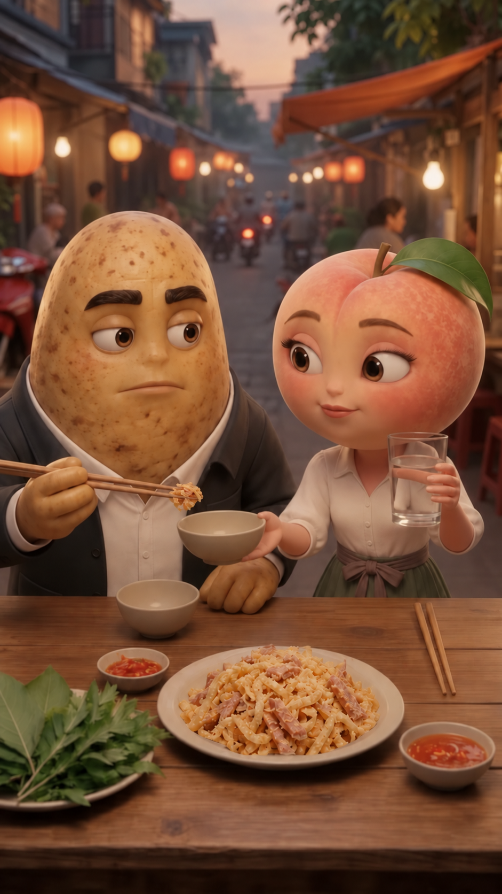
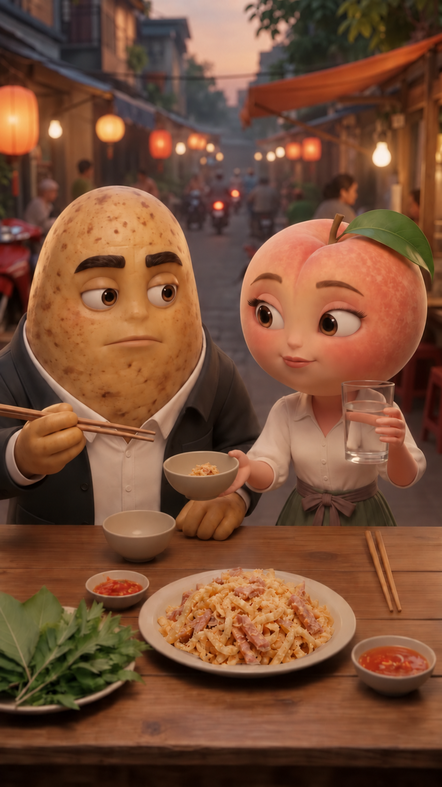

# REC296 — Hai ảnh nháp tư thế nhận–cho, chưa là nguồn sản xuất

13-10-2026. Owner xác nhận **“Duyệt chuẩn bị hai ảnh tham chiếu mới”**. [Approval đúng phạm vi](restart_720p_v1/00_decisions/receiver-pose-images-preparation-approval-296.json): chỉ chuẩn ảnh nháp, kiểm sai lệch rồi trình duyệt; không video trả phí hoặc thay nguồn đã chọn.

## Đã làm và ảnh cần xem

Built-in imagegen, theo skill imagegen: lấy entry v3 làm edit target; kiểm toàn khung; sửa riêng mặt–hướng nhìn Khoai một lần; tạo P2 từ P1 đã sửa để giảm thay đổi bố cục. Không CLI/API hoặc cài mới. Ba lượt tạo ảnh, hai tư thế cần trình; không gọi ba ảnh đều là kết quả cuối.

**P1 v2 — Đào đưa bát riêng rỗng, A còn kẹp:**

**P2 v1 — A đã trong bát Đào, đầu đũa trống và rút ngắn:**

P1 v1 không chọn vì mắt Khoai chưa chú ý Đào; giữ lịch sử riêng, không đưa vào cặp đề nghị. Cả ba output đã copy vào repo, mở kiểm metadata/hash và giữ bản tool output. [Prompt thực](restart_720p_v1/04_requests/receiver-pose-imagegen-prompts-296.md), [lineage và hash](restart_720p_v1/06_qc/receiver_pose_image_evidence_296.json).

## Root kiểm toàn ảnh — phạm vi still, không physics/video PASS

| Nội dung | Quan sát trực tiếp và giới hạn |
| --- | --- |
| Đúng pha nhận–cho | P1: lòng bát Đào rỗng, A ở tips phía trên/gần bát. P2: phần nhỏ ở lòng bát cô, tips trống/rút phía Khoai. Không thấy A đồng thời còn trên đũa và trong bát |
| Người giữ bát/cốc | Bát nhận ở tay trong Đào; cốc vẫn tay ngoài bên phải màn hình, ngoài lòng bát. Bát Khoai riêng vẫn trên bàn và rỗng; không hiện thêm bát thứ ba |
| Tay nghỉ và vùng nhận | Tay trong Khoai còn trên bàn, thấy các ngón. Bát nhận khá gần vùng cổ tay ấy; phải kiểm khoảng hở và đường chuyển trên actual, không suy ảnh chụp chứng minh không va chạm |
| Mặt và diễn | P1 v2 đã sửa mắt Khoai về Đào; P2 giữ hướng đó. Hai mặt còn thấy, Đào nét hiểu nhẹ; không bib hoặc trang phục mới. So entry v3, mặt/scale/chi tiết đã redraw; chưa exact face match hoặc diễn B liên tục đạt |
| Bối cảnh toàn bàn | Giữ quán nhỏ, ánh sáng ấm, rau/lá trước trái, hai chén chấm, đĩa nem và đôi đũa Đào phía phải. Không bỏ rau/chấm để xử lý đường tay |
| Món | Không thấy khói; món là bì/thịt rời phủ thính, không mảng nem vuông đặc. Root xem lại hai ảnh món thật đã duyệt để đối chiếu chất liệu. Lượng A nhìn nhỏ, không bát đầy; still không chứng minh số miếng hoặc lượng bảo toàn theo pixel |
| Sai lệch trong cặp | P2 có dịch nhẹ vị trí/hình dáng bát và chi tiết vùng nhận so P1; không phải cặp pixel-lock. Chỉ xem xét tư thế, không tự đưa thẳng vào Frames hoặc dựng cut |

## Hạn chế phải giữ khi duyệt

- Cả hai ảnh 941×1672: gần dọc 9:16 nhưng **không đúng tuyệt đối**, chưa bản 720×1280. Chưa crop/resize hoặc biến ảnh thành master mới.
- Toàn khung thay tỉ lệ/chi tiết so v3, không chỉ tay–bát. Model đã được yêu cầu bảo toàn; yêu cầu đó không chứng minh giữ pixel. Không ghép ảnh local hoặc thay mặt ngoài quyền mới.
- Cặp này là **tham chiếu dàn cảnh S2/S3**, không phải ảnh đầu C06; C06 phải bắt đầu từ trạng thái giữ A và bát còn trên bàn. Không lấy P2 sau nhận làm START trước nhận. Biểu tượng sao được ảnh sinh giữ/vẽ lại không là chứng cứ frame native Flow; provenance là ảnh ChatGPT-generated theo lineage đã ghi.
- Muốn nối chính xác, phải chuẩn lại theo khung thực của take được chọn. Endpoint đẹp không chứng minh chuyển động giữa ảnh, đúng bát/nhả một lần, diễn, tiếng hoặc lip-sync.
- Giọng K20/D06, N06/N07, sắc thái B, C09 và source276/277 giữ phạm vi đã chốt. REC293 vẫn không chọn. Chưa có paid request mới hoặc thay EDL.

## Phản biện và bước tiếp

[Phản biện độc lập](restart_720p_v1/06_qc/receiver_pose_still_independent_296.md) đã đọc giấy, xem toàn base và ba ảnh sinh, kiểm hash; root đọc toàn report. Cặp P1 v2/P2 v1 đủ trình **hướng tư thế** với caveat bát gần/overlap theo hình chiếu tay Khoai và redraw so base. Không thấy lỗi MAJOR rõ về ý nghĩa S2/S3; chưa xác định actual clearance, exact identity/continuity, chuyển động hoặc voice đạt. Không dùng tên vị trí hoặc metadata làm media PASS.

Đề nghị owner duyệt **tư thế tham chiếu** P1 v2/P2 v1 với các giới hạn trên, không duyệt điểm nối/video/giọng hoặc trả phí. Sau đó chuẩn gói C06 mới từ entry v3, kiểm route/voice/quote live và trình đúng một request riêng trước submit. Nhịp nhận và silent deposit chưa tự chốt số take.

**Đã xác định:** ảnh biểu đạt được bát riêng nhận A. **Đã chốt:** phạm vi tạo ảnh, choreography A và lời/nhân vật giữ. **Giả định:** cặp pose giúp làm rõ đích, chưa kiểm video. **Còn mở:** owner chọn ảnh, khoảng hở/vật lý thực, khớp nguồn/timing 30 giây và món toàn tập. **Bước tiếp:** chốt đúng scope tư thế rồi chuẩn request live, không sinh video từ approval ảnh.

Flow chi mới **0**; sổ dự án **244/500**, còn **256**, retake **19**, dự phòng **110 đóng**. Tool imagegen không công bố chi phí/usage tài khoản; không nói mọi chi phí AI đều bằng 0. Không browser Flow action, voice/source/EDL replacement hoặc release trong REC296.
