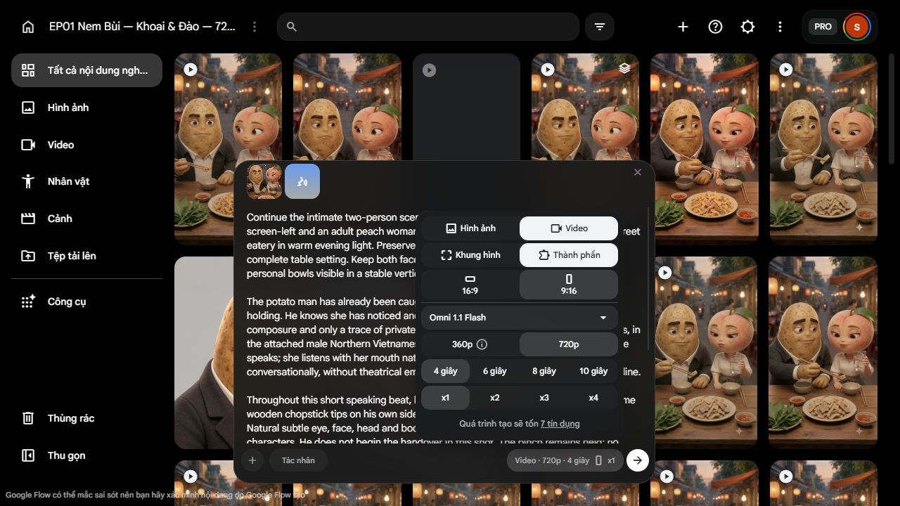

# REC297 — Tư thế đã duyệt, gói C06 giữ A đã chuẩn trên Flow

13-10-2026. Owner duyệt **“Duyệt hướng tư thế P1 v2 / P2 v1”**, chỉ làm tham chiếu dàn cảnh với caveat redraw và bát sát tay Khoai. [Approval](restart_720p_v1/00_decisions/receiver-pose-direction-approval-297.json) không nghiệm thu video/giọng/điểm nối hoặc cấp quyền chạy trả phí.

## 1. Thực hiện tiếp từ approval, không mở lại nhân vật/giọng

Đã chuẩn request **C06_KEEP_A_T01** trong project EP01 hiện có, bằng skill computer-use qua trình duyệt tích hợp. Chỉ chọn tài nguyên đã có, điền prompt và đọc cấu hình/giá; không upload ảnh P1/P2, không sửa preset và **chưa bấm Bắt đầu tạo**.

C06 dùng ảnh entry v3 trước nhận: Khoai giữ A phía mình, Đào chưa đưa bát. P1 v2/P2 v1 giữ là ý đồ S2/S3; không đưa ảnh sau nhận thành ảnh đầu C06 hoặc cặp Frames sản xuất. Khoảng hở bát–tay sẽ chuẩn ở nhịp nhận từ khung thực được chọn, không tự coi caveat đã đóng.

## 2. Gói live và chứng cứ đã đọc

| Thành phần | Hiện hành |
| --- | --- |
| Project/account | EP01 Nem Bùi — Khoai & Đào — 720p v1; `cutebabyshop2026@gmail.com`, Pro; đúng project `bcb1f53c-13b6-4719-b866-01348dfcddd6` |
| Ảnh | Một `C06_ENTRY_LOCAL_v3_FOR_REVIEW_291.png`; picker hiện đúng tên và preview entry, đã thêm vào prompt. Hash local kiểm lại `7c8023…3f8cc`; không tuyên bố đã hash remote blob |
| Giọng | Một saved `EP01_Khoai_K20_Orus_720p_v1`; đọc live tên, mẫu 109 ký tự và đặc điểm nam Bắc đã chốt. AX hiện ID `b447b35c-b35e-4140-af72-ecd277282b1a` trên ba field. Thêm đúng một lần, một chip giọng; không D06/base Orus |
| Prompt | Đúng [C06_ACT v0.3](restart_720p_v1/04_requests/C06_ACT_v0p3_keep_A_295.md), không prompt redirect REC292. Nội dung trên UI khớp nguyên văn; UTF8/LF SHA256 `d1bd57c6ce6c6cf7aece99bb03ab2e28616fc76625765c1665ac717c62925eab` trùng phần prompt trong file |
| Route/model | Video / Ingredients / Omni 1.1 Flash; không Frames + saved voice |
| Output | Dọc 9:16 / 720p / 4 giây / x1; Agent tắt |
| Tiếng | Yêu cầu native N06 với K20, chỉ Khoai nói. UI Omni hiện không lộ một toggle tiếng ON/OFF riêng; không giả đã đọc flag hoặc đã nghe output. Không chạy preview giọng/sửa preset/mute/revoice |
| Giá và số dư | Quote hiện hành **7 credit**, account **986**; chưa debit mới. Cả hai đã xem live, không dùng số cũ thay |

ID live hiện nhìn thấy ở lúc chọn voice, khác giới hạn quan sát REC292. Chip đã gắn không tự lộ ID; bằng chứng là chọn đúng field ID/tên/performance rồi Add một lần và chip xuất hiện, không claim đã đọc backend/request payload.

Chi tiết [preparation JSON](restart_720p_v1/04_requests/C06_KEEP_A_T01_preparation_297.json); folder proof có K20_SELECTED, BALANCE_BEFORE, CONFIG_QUOTE, PREPARED_NOT_SUBMITTED. Tab giữ handoff, không tạo native mới.

## 3. Phép thử/sản xuất đề nghị: chỉ giải quyết C06

**Một lượt, tối đa 7 credit, không tự chạy lại.** Mục tiêu: đúng một N06/K20, nét B và cùng A vẫn kẹp phía mình sau câu; Đào nghe, bát cô còn rỗng trên bàn, cốc ngoài bát. Không đưa A về đĩa chung, chưa chuyển dài/nhả/ăn. Giữ hai mặt, props/món lạnh/trang phục và liên tục C05.

Đây là request mới sau REC293 không chọn, không quyền retry còn sót. Không hứa chắc đạt, không hứa toàn kết đủ 19 credit chỉ vì quote C06 là 7. Ingredients có thể lệch entry/diễn/voice; ảnh vào và prompt không khóa physics hoặc exact F0. Chọn thời lượng sinh 4 giây là mức UI hiện hành, không bắt dùng trọn 4 giây trong phim hoặc ép range 57F.

Nếu được duyệt: kiểm lại gói/quote không đổi rồi submit đúng x1; nếu giá, model, inputs hoặc route khác thì dừng. Tải native720p, hash/decode và kiểm toàn khung, đặc biệt giữ A/đúng tay/bát/cốc và đủ câu. Kiểm nghe/AV/diễn thực đúng file; nếu AI thiếu capability, trình owner checkpoint tương ứng, không lấy ASR làm nghe. Sai hành động/voice/miệng/continuity thì không chọn và không tự retry. Chỉ sau chọn C06 mới chuẩn input nhận từ khung thực, giữ khoảng hở và phạm vi approved pose.

## 4. Timing và ngân sách: vẫn có giới hạn chưa giải quyết

Trước C06 là 632F/24fps; C06 mới N thì final30 phần nhận/N07/cho/C09 còn **88−N** khung. Cần đo range thật và rà đoạn dư phía trước trước khi trình thay cut; chưa tự sửa EDL, bỏ lời/C09 hoặc đổi final thành 35 giây. Món toàn tập cũng chưa đóng. Không sinh cả chuỗi rồi gọi sẵn sàng bàn giao.

Sổ hiện tại **244/500, còn 256; retake 19; dự phòng 110 đóng**. Nếu owner duyệt và actual debit đúng 7: dự kiến **251/500, còn 249; retake 12**; account có thể 979 nếu không có debit khác. Đây **dự kiến**, không ghi thành chi thực. Không lấy 986 số dư account làm ngân sách được phép của project.

## 5. Kiểm độc lập và quyết định tiếp

[Phản biện độc lập](restart_720p_v1/06_qc/C06_KEEP_A_preflight_independent_297.md) đã đọc gói và xem bốn screenshots; root đọc toàn report. Không thấy blocker mới trên giấy/chứng cứ UI đã lưu, đủ trình đúng một lượt tối đa 7 với các unknown được công bố; **không** actual control/diễn/voice/AV hoặc paid GO. C06 chỉ lời/giữ A, không yêu cầu giải quyết transfer chưa có control trong cùng lượt. Không cần tuyển agent mới hoặc hỏi lại sắc thái B/K20/D06.

**Đã xác định:** tư thế nhận–cho được owner chọn, gói C06 mới có đúng ảnh/voice/prompt/config/quote. **Đã chốt:** scope pose và choreography, chưa trả phí. **Giả định:** giảm chuyển động trọng yếu trong lượt nói sẽ giảm rủi ro, chưa thử. **Còn mở:** quyền một lượt 7, actual C06, nhịp nhận/clearance, timing/món toàn tập. **Bước tiếp:** owner chốt đúng một lượt C06_KEEP_A_T01 sau read-back report; không tự tiếp từ approval pose.

Flow chi mới **0**, native mới **0**, source/voice/EDL replacement **0** trong REC297.
